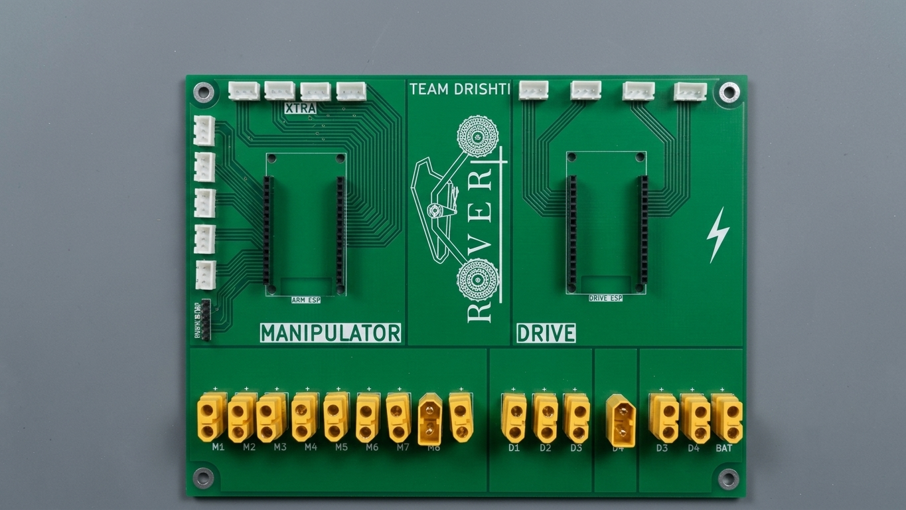

# PCB-POWER_CKT-IRC2025

Combined Drive and 6-DOF Manipulator high-current power distribution board engineered for the **International Rover Challenge (IRC)** at BITS Goa.

> **Achievement:** Ranked **14th in Finals** at International Rover Challenge (SPROS), representing **Drishti Robotics Club, SVNIT Surat**.

---

## Fabricated Hardware Board



---

## Technical Specifications

| Parameter | Specification |
| :--- | :--- |
| **Competition** | International Rover Challenge (IRC) — BITS Goa |
| **Team / Affiliation** | Drishti Robotics Club, SVNIT Surat |
| **Result** | Ranked 14th in Finals (International Finalist) |
| **Input Power** | Dual 14V (4S Li-Po) Battery Inputs |
| **Current Capacity** | Up to 180A peak current handling |
| **Drive Outputs** | 4x XT60 connectors (4-wheel drive motors) |
| **Manipulator Outputs** | 6x XT60 connectors (6-DOF robotic arm) |
| **Logic Power** | Integrated buck converter rail for ESP32 |
| **Safety** | Competition-compliant Emergency Kill Switch circuit |
| **EDA Tool** | KiCad 8.0 |

---

## Subsystem Architecture

- **Drive Power Stage:** High-current copper pours designed to handle surge currents across 4 independent motor drivers via XT60 terminals.
- **Manipulator Power Stage:** Dedicated distribution bus for 6 robotic arm joint actuators.
- **Logic & Control (ESP32):** Stepped-down, isolated power rail to prevent MCU brownouts during high motor draw.
- **Safety Loop:** Hardware kill switch interface to cut primary power in emergency conditions.

---

## Repository Files

- `POWER CKT & ARMHAND PCB.kicad_pro` — KiCad 8.0 project file
- `POWER CKT & ARMHAND PCB.kicad_sch` — Schematic design
- `POWER CKT & ARMHAND PCB.kicad_pcb` — 2-layer PCB layout & trace routing
- `POWER CKT & ARMHAND PCB.kicad_prl` — Project local settings
- `PCB_ROVER-REV2.0.png` — 3D PCB layout render
- `PCB_ROVER_ORG_PIC-REV2.0.jpeg` — Fabricated PCB photograph

---

## Getting Started

1. Requires **[KiCad 8.0+](https://www.kicad.org/)**.
2. Clone this repository:
   ```bash
   git clone https://github.com/dakshraj05/PCB-POWER_CKT-IRC2025.git
   ```
3. Open `POWER CKT & ARMHAND PCB.kicad_pro` in KiCad.

---

## Author

**Dakshrajsinh Gohil**  
B.Tech in Electronics & Communication Engineering, SVNIT Surat  
- **GitHub:** [@dakshraj05](https://github.com/dakshraj05)  
- **LinkedIn:** [dakshrajsinhgohil](https://linkedin.com/in/dakshrajsinhgohil)
